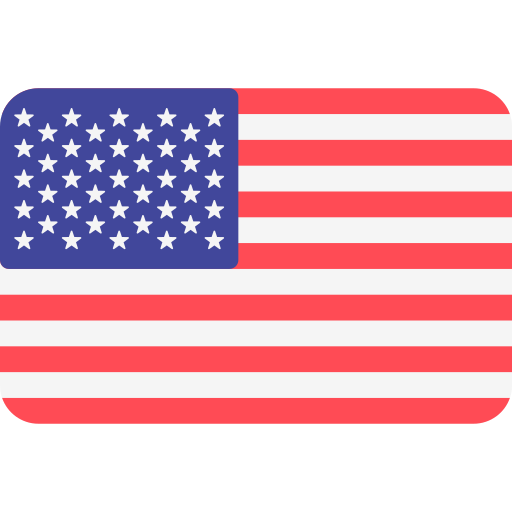
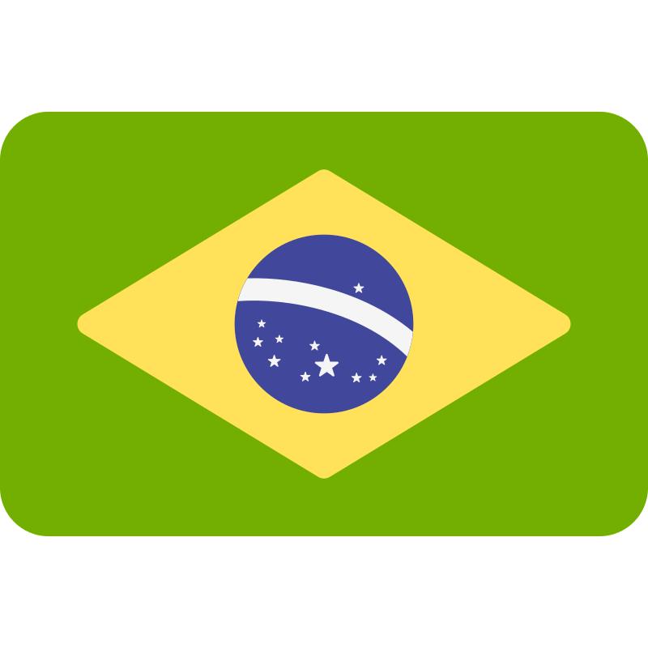

  

  

# 👋 Bem-vindo(a) ao meu perfil!

- 🎓 [Técnico em Informática](https://www.ifms.edu.br/campi/campus-aquidauana/cursos/integrado/informatica) pelo [IFMS](https://www.ifms.edu.br/) (2017-2021)
- 🏆 Finalista FETECMS 2018 com o projeto "IFMS Aqui Comunica: Scrum" (2018)
- 🔬 Bolsista PIBIC-EM do projeto "[Kalivôno: promovendo o acesso à língua Terena por meio de um app progressivo](https://kalivono.vercel.app)" (2019-2020)
- 🎓 [Tecnólogo em Sistemas para Internet](https://www.ifms.edu.br/campi/campus-aquidauana/cursos/graduacao/sistemas-para-internet/sistemas-para-internet) pelo [IFMS](https://www.ifms.edu.br/) (2021-2025)
- 🔬 Bolsista PIBIC do projeto "Desenvolvimento de um aplicativo para acompanhamento dos egressos do IFMS" (2021-2022)
- 📄 [GOMES, Matheus Daniel Cristal Comparotto. Desenvolvimento de um aplicativo para acompanhamento dos egressos do IFMS. Revista Científica da Campus Party Goiás, n. 4, p. 24, 2024](https://brasil.campus-party.org/wp-content/uploads/2025/07/Revista-Cientifica_CPGoias4.pdf#page=24)
- 🎓 Ingressante no [Mestrado Profissional em Computação Aplicada](https://www.facom.ufms.br/ppgcc/) na [UFMS](https://posgraduacao.ufms.br/portal) (2027~)

## Conheça meus projetos

  <!--  -->

  

  

## Pilha de tecnologias

### Linguagens de programação

### Front-end

### Back-end

### DevOps

### Bases de dados

### Testes

<!--

-->

## Meus meios de contato

  

  

  

